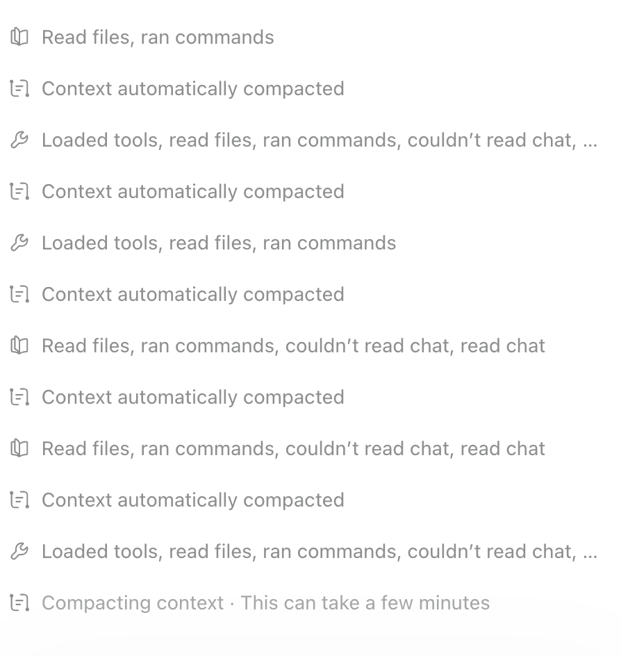

# Premature automatic compaction



The reporter supplied this unedited screenshot on 19 November 2026. It shows five completed
automatic compactions and a sixth in progress. It documents repetition, without establishing
elapsed time, request size or root cause on its own.

Matching sanitized diagnostics from the installed combined candidate:

```text
2026-11-19 15:47:48 Europe/Berlin
compaction_capacity_reserve
inputTokens=86867 stagedTokens=138778 ceiling=120000 reportedInputTokens=110000

2026-11-19 15:58:31 Europe/Berlin
compaction_capacity_reserve
inputTokens=81611 stagedTokens=127387 ceiling=120000 reportedInputTokens=110000
```

These events came from the GPT-6 High route with the Plus profile and Bigger Context enabled.
The model family is distinct from the shared internal `gpt-5.6-sol` backend identifier. The
repository configures GPT-6 Plus at 120k total / 110k automatic compaction, GPT-6 Pro at
240k / 220k, and GPT-5.6 High Plus at 270k / 240k. No configured context window is raised here.

The initial revision of this PR scheduled compaction once inline usage crossed the ordinary
80k threshold and a hypothetical staged encoding exceeded 120k. That could inflate usage to
110k while the actual inline request and a small pending tool result still fit.

The correction checks projected continuation size instead. It counts the emitted answer or
tool call, the explicit output budget of the outer `exec_command` / `write_stdin` tools, and
framing headroom. Unknown tools retain the ordinary reserve. A similarly named argument on
an unrelated tool is not treated as an enforced output limit. Compaction is requested when
the continuation threatens the final fitting transport and staged input also exceeds its
ceiling. The native compaction loop and browser preflight remain responsible for their checks.

Offline reconstruction of a real work step, including its recorded 2,000-token tool budget,
reported 80,920 tokens as 110,000 before this correction and 80,920 afterward. The replay was
reconstructed from Native history, not a captured original HTTP request; its estimate differs
from the live diagnostic above. Its private task text and paths are excluded.

Public regressions cover fitting inline code, bounded small reads, a large result that would
exceed both available transports, checkpoint continuations, unknown tools, and the wider
GPT-5.6 profile. Live post-install observations and full verification limits belong in the PR
description; the screenshot is evidence of the original symptom, not proof of remediation.
