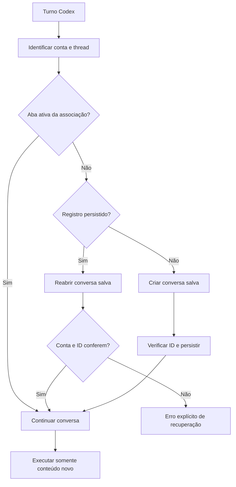

# Plano: uma sessão Codex = uma conversa ChatGPT

> **Implementação em andamento:** a primeira versão usa o registro JSON atômico do Launcher,
> compatível com sua infraestrutura existente, em vez de adicionar uma dependência SQLite.
> A recuperação persistente exige `setup --saved-chats` e modo Automatic Full com reutilização
> habilitada. A conta autenticada é verificada após recuperar a conversa. As garantias de
> reinício foram exercitadas por testes locais de persistência e navegação simulada;
> ainda falta validação ponta a ponta com uma sessão real do ChatGPT, inclusive `codex resume`.
> Temporary Chat e Zero Risk continuam com suas limitações anteriores.

## Objetivo

Manter uma associação **1:1 e durável** entre uma sessão (`thread_id`) do Codex e uma conversa do ChatGPT, inclusive após compactação de contexto, `codex resume` e reinicialização do Launcher. Novos turnos devem continuar na conversa existente sem reinjetar todo o histórico a cada chamada.

## Situação atual

- A reutilização de uma aba física já funciona em memória para turnos comuns e compactações bem-sucedidas, enquanto o Launcher permanece ativo.
- `launcher/electron/browser-host.cjs` retém abas por `conversationKey`, mas seu mapa de abas desaparece quando o Launcher encerra.
- `src/adapters/chatgpt-web/browser-worker.ts` prepara uma página de **nova conversa**; não existe um fluxo completo para reabrir uma conversa persistida.
- `src/adapters/chatgpt-web/conversation-key.ts` inclui modelo e esforço de raciocínio na chave atual; isso pode criar outra identidade para a mesma sessão Codex.
- `setup --saved-chats` existe, mas salvar conversas não equivale, por si só, a associá-las e recuperá-las por `thread_id`. O padrão atual usa Temporary Chat.

As modificações em andamento no repositório devem ser preservadas durante a implementação deste plano.

## Alternativas consideradas

| Alternativa | Vantagem | Limitação | Decisão |
| --- | --- | --- | --- |
| Manter somente a aba em memória | Simples e já disponível | Não sobrevive ao reinício do Launcher | Manter como caminho rápido |
| Persistir `thread_id → conversation_id/URL` | Permite recuperar exatamente a conversa original | Depende de uma conversa reabrível e de identificação confiável | **Adotar** |
| Criar outro chat e reinjetar todo o contexto | Pode continuar uma tarefa sem o chat anterior | Rompe 1:1 e reintroduz limites de tamanho/duplicações | Somente fallback explícito do usuário |

## Contrato de identidade

A chave lógica da associação será **`(account_id, codex_thread_id)`**. A identidade não pode depender de `model_id`, reasoning effort, época de compactação, ID do turno ou ciclo de vida do Launcher.

Cada chave pode apontar para **no máximo uma conversa ChatGPT**, e uma conversa não pode ser atribuída a duas chaves diferentes. Se trocar modelo ou esforço não for suportado na conversa recuperada, apresentar um erro específico; não abrir outro chat silenciosamente.

### Registro persistente sugerido

Usar SQLite em um diretório persistente de dados do usuário do Launcher, fora do repositório e de diretórios temporários do AppImage. Armazenar uma impressão estável da identidade da conta, sem credenciais ou cookies.

```sql
CREATE TABLE conversations (
  account_id TEXT NOT NULL,
  codex_thread_id TEXT NOT NULL,
  chatgpt_conversation_id TEXT NOT NULL,
  chatgpt_conversation_url TEXT NOT NULL,
  status TEXT NOT NULL,
  created_at TEXT NOT NULL,
  updated_at TEXT NOT NULL,
  PRIMARY KEY (account_id, codex_thread_id),
  UNIQUE (account_id, chatgpt_conversation_id)
);
```

O formato definitivo deve acompanhar as abstrações e o armazenamento já utilizados pelo Launcher, evitando introduzir dependências adicionais. Preferir uma transação atômica ao confirmar uma nova associação.

## Fluxo de execução

1. Identificar o `codex_thread_id` real e a conta ChatGPT autenticada.
2. Consultar a aba ativa pertencente à mesma associação. Se existir, utilizá-la.
3. Sem aba ativa, consultar o registro persistente.
4. Havendo registro, navegar diretamente para a URL salva e validar que a conversa carregada, a conta autenticada e o compositor correspondem ao registro.
5. Sem registro, criar uma conversa **salva**, enviar a primeira mensagem, verificar o ID/URL atribuído pelo ChatGPT e persistir a associação. Não registrar uma URL genérica de nova conversa.
6. Submeter apenas o novo turno ou sufixo necessário, preservando a conversa original durante a compactação e retomada.
7. Se a conversa persistida não puder ser recuperada, falhar de forma explícita e orientar a recuperação manual; não criar uma conversa substituta sob a mesma chave.



## Etapas de implementação

### 1. Provar que a recuperação é viável

- Validar, em ambiente isolado, o comportamento de `setup --saved-chats` e o reaproveitamento de uma URL `/c/<id>` após fechar e abrir o Launcher.
- Confirmar que a conta e a conversa podem ser identificadas sem depender de títulos, ordenação do histórico ou seletores frágeis.
- Verificar o comportamento quando uma conversa é excluída, a sessão de login expira e a conta autenticada muda.
- **Bloqueio de desenho:** Temporary Chat não deve ser prometido como recuperável após reinício. Se não houver identificação/reabertura confiável, documentar a limitação antes de avançar.

### 2. Estabilizar a chave lógica

- Separar a chave durável `(account_id, thread_id)` das configurações de execução (`model_id`, reasoning effort, época de compactação).
- Ajustar `conversation-key.ts` e consumidores para evitar que parâmetros transitórios gerem chats distintos.
- Preservar a compatibilidade com as associações ainda ativas em memória na versão instalada.

### 3. Criar o `ConversationRegistry`

- Implementar leitura, gravação, consulta e migração de esquema com persistência atômica.
- Garantir unicidade por sessão e propriedade exclusiva de cada conversa.
- Não persistir cookies, senhas, transcrições nem prompts no registro.
- Proteger o banco contra escrita concorrente e definir recuperação após queda entre enviar a primeira mensagem e gravar seu ID: procurar a conversa recém-criada com evidência segura ou declarar estado ambíguo, sem duplicar a mensagem automaticamente.

### 4. Conectar o registro ao navegador

- Em `launcher/electron/browser-host.cjs`, consultar primeiro a aba ativa; depois, o registro persistente.
- Em `src/adapters/chatgpt-web/browser-worker.ts`, implementar uma navegação específica para **conversa existente**, distinta de `prepareChatSurface` para novos chats.
- Confirmar conta, ID da conversa e compositor pronto antes do envio; nunca deduzir sucesso somente de uma navegação HTTP.
- Atualizar `src/adapters/chatgpt-web/index.ts` e os tipos/protocolo necessários para transportar a identidade estável e o resultado de recuperação.

### 5. Integrar compactação, `resume` e concorrência

- Manter a associação no handoff de compactação e enviar apenas o sufixo novo para o chat recuperado.
- Fazer `codex resume` usar o mesmo `thread_id` e o mesmo mapeamento, independentemente de um novo processo do Codex.
- Serializar a escrita na mesma conversa para evitar mensagens intercaladas.
- Registrar IDs de turnos processados ou outro mecanismo de deduplicação verificável antes de repetir um envio após timeout. Uma resposta incerta exige reconciliação, não reenvio cego.
- Em caso de mudança de conta ou exclusão do chat, apresentar falha recuperável visível ao usuário.

### 6. Testar e disponibilizar

- Testes unitários do registro, chave estável, colisões e migrações.
- Testes de integração da recuperação de uma conversa salva, validação de conta, reinício e repetição após falha.
- Testes de regressão do fluxo existente de abas retidas, handoff e envio por sufixo.
- Documentar a necessidade de chats salvos e o comportamento de sessões antigas criadas como Temporary Chat.
- Empacotar e validar a versão instalada, respeitando as mudanças locais já presentes.

## Critérios de aceite

| Cenário | Resultado exigido |
| --- | --- |
| Dez turnos na mesma sessão Codex | Exatamente uma conversa ChatGPT |
| Compactação seguida de novo turno | Mesmo ID de conversa, sem histórico duplicado |
| Fechar e reiniciar o Launcher | Recuperar o mesmo ID de conversa |
| `codex resume` | Recuperar o mesmo ID de conversa |
| Duas sessões Codex distintas | Conversas distintas, sem vazamento cruzado |
| Mudança de modelo/esforço | Mesmo chat se suportado; erro explícito caso contrário |
| Chat salvo indisponível ou conta incorreta | Nenhum novo chat criado automaticamente |
| Timeout ou queda durante envio | Reconciliar antes de qualquer reenvio |
| Temporary Chat não recuperável | Limitação explícita; não afirmar persistência 1:1 |

## Riscos e decisões pendentes

1. **Chats temporários:** o modo padrão atual pode impedir persistência entre processos. Verificar o comportamento real antes de exigir ou sugerir uma mudança de configuração.
2. **Primeiro envio:** a conversa pode nascer no servidor antes de o Launcher salvar seu ID; tratar esse intervalo como caso de consistência importante.
3. **Mudanças na interface ChatGPT:** validação e recuperação devem falhar de forma observável quando seletores ou rotas mudarem.
4. **Sessões antigas:** um chat temporário mantido apenas na memória poderá continuar até o Launcher reiniciar; não há como garantir migração retroativa se o ID nunca foi persistido.

**Definição de pronto:** os testes demonstram que o mesmo `codex_thread_id`, sob a mesma conta, mantém o mesmo `chatgpt_conversation_id` após compactação, `resume` e reinício, sem recriação silenciosa nem reinjeção integral do contexto.
